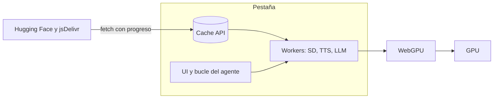

# webgpu-test

Inferencia en la GPU del propio ordenador, dentro de una pestaña. No hay un servidor que ejecute el modelo: el navegador descarga los pesos, los guarda en la caché y los corre con WebGPU. Este repositorio se llama **webgpu-test**. El encargo original decía «ejemplo/WebGL»; el contenido es WebGPU (el sucesor de WebGL para cómputo), así que el nombre del repo usa ese término y esta página deja constancia de los dos.

Hay dos demos estáticas, HTML y JavaScript en módulos ES, sin empaquetador y sin framework. Hace falta un servidor de ficheros. Abrir los HTML con doble clic (`file://`) no funciona.

## Índice

1. [Arranque en local](#arranque-en-local)
2. [Qué es WebGPU](#qué-es-webgpu)
3. [Arquitectura](#arquitectura)
4. [Demo 1 — sd-phased](#demo-1--sd-phased)
5. [Demo 2 — agent-suite](#demo-2--agent-suite)
6. [Descarga y caché](#descarga-y-caché)
7. [Cuantización y el objetivo de 8 GB](#cuantización-y-el-objetivo-de-8-gb)
8. [Desplegar en GitHub Pages](#desplegar-en-github-pages)
9. [Limitaciones](#limitaciones)
10. [Privacidad](#privacidad)
11. [Licencia y créditos](#licencia-y-créditos)

## Arranque en local

`file://` no sirve. Un módulo ES cargado desde disco no puede hacer `fetch` de Hugging Face (el origen es opaco y el navegador bloquea la petición), y a menudo tampoco importa el módulo de al lado. Las dos demos lo detectan (`location.protocol === "file:"`) y muestran un aviso arriba del todo. Si ves ese aviso, no estás en el servidor.

Desde la raíz de este repositorio:

```bash
python3 -m http.server 8000
```

Si el ejecutable se llama `python`:

```bash
python -m http.server 8000
```

Abre [http://localhost:8000](http://localhost:8000). Las demos están en:

- [http://localhost:8000/demos/sd-phased/](http://localhost:8000/demos/sd-phased/)
- [http://localhost:8000/demos/agent-suite/](http://localhost:8000/demos/agent-suite/)

Otra forma, si tienes Node:

```bash
npm start
# equivale a python3 -m http.server 8000

npm run serve
# npx serve en el puerto 8000, la primera vez baja el paquete
```

`npm run check` ejecuta `node shared/selfcheck.mjs` (planificador, float16 y el parser de herramientas). No descarga modelos.

El servidor solo entrega ficheros. La inferencia ocurre en el navegador. La primera visita sí usa la red: el runtime llega desde jsDelivr y los pesos desde Hugging Face. Sin red no hay primera carga. Con la caché llena, una visita posterior puede generar sin volver a bajar los pesos; los scripts del CDN hacen falta otra vez si el navegador no los tiene.

### Navegador

Hace falta WebGPU y la feature `shader-f16`. Sin f16 los modelos en float16 y en q4f16 no arrancan; la página lo dice y no empieza la descarga grande.

| Navegador | Situación práctica |
| --- | --- |
| Chrome / Edge actuales | WebGPU viene activado en escritorio. En versiones viejas: `chrome://flags/#enable-unsafe-webgpu`. |
| Safari | Escritorio reciente e iOS reciente. Si no aparece `navigator.gpu`, revisa los ajustes experimentales de WebGPU en Safari Technology Preview o en Desarrollo. |
| Firefox | Flag `dom.webgpu.enabled` en `about:config`. El soporte va por detrás de Chromium. |

Comprueba también que la GPU exponga `shader-f16`. Algunas integradas antiguas anuncian WebGPU y aun así fallan esa feature. Los controladores desactualizados dan el mismo síntoma: hay API, no hay adaptador.

El runtime WASM queda en un solo hilo (`shared/wasm-threads.js`). Hace falta `Cross-Origin-Opener-Policy` y `Cross-Origin-Embedder-Policy` para `SharedArrayBuffer` y el WASM multihilo. Ni `python -m http.server` ni GitHub Pages pueden poner esas cabeceras. Con un hilo la página arranca igual. El detalle está en [Desplegar en GitHub Pages](#desplegar-en-github-pages).

## Qué es WebGPU

WebGPU es la API del navegador para hablar con la GPU: gráficos y, sobre todo aquí, cómputo general. Sustituye a WebGL. WebGL dibujaba con un pipeline gráfico fijo y shaders GLSL. WebGPU expone colas de comandos, buffers y shaders de cómputo, más cerca de Vulkan, Metal y D3D12.

En estas demos el recorrido es este:

1. JavaScript pide un `GPUAdapter` y un `GPUDevice`.
2. ONNX Runtime Web (y, por debajo de transformers.js, el mismo runtime) traduce el grafo ONNX a pipelines de WebGPU.
3. El runtime escribe los pesos en buffers de la GPU y lanza compute shaders. Esos shaders no están escritos a mano en este repo: los genera el runtime a partir de cada operador (matmul, softmax, convolución, atención).
4. El resultado vuelve a la CPU solo donde hace falta: tokens de texto, latentes entre pasos del scheduler, píxeles del VAE, muestras de audio.

La VRAM no es un cajón aparte. En un portátil es la misma memoria que usa el escritorio. Un modelo que «cabe» en el papel puede tumbar la pestaña si el compositor y el resto de Chrome ya ocupan varios gigabytes.

## Arquitectura



En texto: la pestaña corre un bucle en JavaScript. Los workers piden los ficheros, la Cache API los guarda, y WebGPU empuja el cálculo a la GPU. No hay un cuarto proceso en un servidor tuyo.

```
pestaña
  ├─ UI (progreso, chat, canvas)
  ├─ worker SD  ── ONNX Runtime Web ── WebGPU ── GPU
  ├─ worker TTS ── transformers.js  ── WebGPU ── GPU
  └─ worker LLM ── transformers.js  ── WebGPU ── GPU
         ▲
         └── fetch → Cache API  (clave distinta para los ONNX de SD
                                 y para la caché "transformers-cache")
```

## Demo 1 — sd-phased

Carpeta `demos/sd-phased/`. Genera una imagen 512×512.

transformers.js no tiene pipeline `text-to-image` (la tabla oficial lo marca como no soportado). El tokenizador CLIP sí: `Xenova/clip-vit-base-patch16`. El UNet, el text encoder y el decoder del VAE se ejecutan con ONNX Runtime Web, en la línea del ejemplo de SD-Turbo de Microsoft.

### Fase A — modelo pequeño

| | |
| --- | --- |
| Repositorio | [subpixel/small-stable-diffusion-v0-onnx-ort-web](https://huggingface.co/subpixel/small-stable-diffusion-v0-onnx-ort-web) |
| Modelo de origen | [OFA-Sys/small-stable-diffusion-v0](https://huggingface.co/OFA-Sys/small-stable-diffusion-v0) |
| Ficheros | `text_encoder/model.onnx` (246 MB), `unet/model.onnx` (757 KB) + `unet/weights.pb` (1,16 GB), `vae_decoder/model.onnx` (99 MB) |
| Descarga | **1,50 GB** |
| Pasos | 12 por defecto, Euler discreto, guidance 7,5. La ficha publica DPM-Solver++; Euler usa la misma agenda de betas `scaled_linear` y cabe en unas decenas de líneas. |
| Entradas del UNet | `sample`, `timestep` y `encoder_hidden_states` en **float16**. Atención cruzada de 768. |
| VRAM orientativa | 4 GB libres, mejor 6 GB. El UNet externo y el text encoder conviven con la pestaña. |

Cuando los ficheros están en caché y la sesión WebGPU responde, el botón Generar se activa. Recién entonces arranca la fase B. Así el modelo grande no compite por RAM con la primera lectura del pequeño.

### Fase B — SD-Turbo

| | |
| --- | --- |
| Repositorio | [schmuell/sd-turbo-ort-web](https://huggingface.co/schmuell/sd-turbo-ort-web) |
| Modelo de origen | [stabilityai/sd-turbo](https://huggingface.co/stabilityai/sd-turbo) |
| Ficheros | `text_encoder/model.onnx` (681 MB), `unet/model.onnx` (1,73 GB), `vae_decoder/model.onnx` (99 MB) |
| Descarga | **2,51 GB** |
| Pasos | Uno. Sigma 14,6146, timestep 999, sin guidance. Es la receta del ejemplo [onnxruntime-inference-examples/js/sd-turbo](https://github.com/microsoft/onnxruntime-inference-examples/tree/main/js/sd-turbo). |
| Atención cruzada | 1024 (SD 2.1). |
| VRAM orientativa | 8 GB libres. El UNet son 1,7 GB en un solo `ArrayBuffer`, más la copia que la GPU se queda. |

Puedes alternar entre los dos cuando ambos están descargados. Cambiar de modelo suelta la sesión anterior y crea la nueva desde la caché: tener los dos UNet a la vez en VRAM tumba máquinas de 8 GB. «Vaciar caché» borra la Cache API de estos ONNX (`ejemplo-webgpu-models-v1`) y vuelve a empezar por la fase A.

El prompt se entiende mejor en inglés. Hay semilla opcional.

### Pasos

1. Sirve el repo (`python3 -m http.server 8000`).
2. Abre `/demos/sd-phased/`.
3. Espera la barra de la fase A. La primera creación de sesión compila shaders y puede tardar un minuto sin mover la barra de red.
4. Pulsa Generar.
5. Deja que la fase B termine si quieres SD-Turbo, y pulsa «Usar SD-Turbo».

## Demo 2 — agent-suite

Carpeta `demos/agent-suite/`. Tres componentes, cada uno con su barra. El cuadro de chat permanece desactivado hasta que el LLM está cargado.

### Componente 1 — imagen

El mismo Small Stable Diffusion v0 de la demo 1 (1,50 GB), el mismo worker (`shared/sd-worker.js`). Lo usa la herramienta `generate_image`.

### Componente 2 — voz

| | |
| --- | --- |
| Repositorio | [Xenova/mms-tts-spa](https://huggingface.co/Xenova/mms-tts-spa) |
| Origen | [facebook/mms-tts-spa](https://huggingface.co/facebook/mms-tts-spa) |
| Runtime | `pipeline("text-to-speech")` de transformers.js 4.3.2, dtype `q8` |
| Pesos | `onnx/model_quantized.onnx`, **38,4 MB** |
| Alternativa | `Xenova/mms-tts-eng` (inglés, mismo tamaño). Cambia `TTS_MODEL_ID` en `shared/models.js`. |

La voz por defecto es española porque la interfaz lo es. MMS inglés pronuncia mal el español, y al revés. Si WebGPU rechaza el grafo, el worker reintenta en WASM y lo escribe en el estado: un modelo de 38 MB sí es viable en CPU.

Hay un botón «Probar una frase» que no pasa por el LLM.

### Componente 3 — lenguaje

El identificador y el dtype son constantes en `shared/models.js` (`LLM_PRESETS`, `DEFAULT_LLM_PRESET`). La página deja elegir antes de descargar.

| Preset | Repositorio | dtype | Descarga contada | Papel |
| --- | --- | --- | --- | --- |
| `olmo-q4f16` (defecto) | [onnx-community/Olmo-3-7B-Instruct-ONNX](https://huggingface.co/onnx-community/Olmo-3-7B-Instruct-ONNX) | `q4f16` | **3,81 GB** (grafo + 2 shards + `tokenizer.json`) | El grande que cabe. Origen: [allenai/Olmo-3-7B-Instruct](https://huggingface.co/allenai/Olmo-3-7B-Instruct). |
| `olmo-q8` | el mismo | `q8` → `model_quantized.onnx` | **7,62 GB** en 4 shards, cada uno por debajo de 2 GiB | El objetivo cercano a 8 GB. Hace falta una GPU con 12–16 GB libres. |
| `qwen3-4b-q4f16` | [onnx-community/Qwen3-4B-ONNX](https://huggingface.co/onnx-community/Qwen3-4B-ONNX) | `q4f16` | **2,83 GB** de ONNX | Más pequeño. Suele obedecer mejor el JSON. Origen: Qwen3-4B. |

Los tres están etiquetados para transformers.js (Olmo y Qwen3-4B) o, en el caso de Qwen, exportados en el mismo layout `onnx/model_q4f16.onnx` + datos externos. La ficha de Olmo pide transformers.js ≥ 4.0. Aquí se fija la 4.3.2.

La barra del LLM está a propósito en grande: porcentaje, bytes y ETA. «Cancelar y elegir otro» mata el worker (y con él el `fetch`). «Vaciar caché del LLM» borra `transformers-cache`. Esa caché también guarda el tokenizador CLIP y la voz; la de Stable Diffusion es otra.

VRAM orientativa: 8 GB para q4f16 de Olmo 7B, contando KV cache de unas pocas frases. 16 GB para el preset q8. La primera compilación de shaders añade un rato largo con la barra ya al 100 %.

### Bucle del agente

1. El usuario escribe. Hasta que el LLM no está listo, el textarea no se activa.
2. El worker genera con `TextStreamer` y `do_sample: false`. Los trozos de texto llegan a la burbuja.
3. Si la respuesta trae una herramienta, se ejecuta y el resultado entra en el chat (imagen o audio).
4. Hay un segundo turno, ya sin herramientas, para que el modelo acuse el resultado. No hay más vueltas.

Formato pedido en el prompt de sistema:

````
```tool
{"tool":"generate_image","arguments":{"prompt":"a red door at night, film still"}}
```
````

````
```tool
{"tool":"speak","arguments":{"text":"Frase corta en el idioma del usuario."}}
```
````

El parser (`shared/tools.js`) también acepta un bloque `json`, una etiqueta `<tool>` y un objeto suelto con `tool` o `name`. Ignora un `<think>…</think>`. El prompt de la imagen tiene que ir en inglés; el texto de `speak` va en el idioma del usuario y se corta a 280 caracteres. Un modelo de 7B cuantizado a veces no emite el bloque: la burbuja muestra entonces solo el texto. Qwen3 4B es el preset pensado para ese caso.

### Pasos

1. Sirve el repo y abre `/demos/agent-suite/`.
2. Imagen y voz empiezan solas. El LLM no: elige el tamaño y pulsa «Descargar el modelo de lenguaje».
3. Cuando el porcentaje llega al 100 % y el estado dice que el chat acepta mensajes, escribe.
4. Prueba: «Dibuja un faro de latón al anochecer» o «Di en alto: la inferencia ocurre en esta pestaña».

## Descarga y caché

Las fases existen porque bajar 1,5 GB y después 2,5 GB, o 3,8 GB de un LLM, en un solo bloque deja la página muda y no permite generar con lo que ya llegó. Cada fase tiene su barra: bytes cargados, total, porcentaje y ETA. La ETA ignora los ficheros que salieron de caché, para no marcar «unos segundos» y luego dispararse cuando empieza el UNet.

Stable Diffusion usa `shared/download.js` y la caché `ejemplo-webgpu-models-v1`. La clave es la URL de `resolve/main` en Hugging Face, no la URL final del CDN tras la redirección. Un fichero completo se guarda; un corte a mitad no. La Cache API solo almacena respuestas enteras. Reanudar con `Range` exigiría guardar el trozo parcial en otro sitio (IndexedDB) y volver a pedir `Range: bytes=N-`. No está hecho: un fichero interrumpido vuelve a empezar, los que ya terminaron no. IndexedDB aguanta blobs grandes y permite ese parcial, a cambio de más código y de copiar el mismo gigabyte otra vez al leerlo. La Cache API encaja con `fetch` y la comparte el worker con la página.

transformers.js usa su propia caché, `transformers-cache`, también por Cache API (`env.useBrowserCache`). El LLM y el TTS informan del progreso con `progress_callback` (bytes por fichero). El denominador de la barra del LLM es la suma conocida de los shards, para que no salte al 100 % cuando acaba el tokenizador de unos megas y todavía faltan los pesos.

Hugging Face responde con `Access-Control-Allow-Origin: *` en `resolve`. Si copias los pesos a tu propio servidor, sin esa cabecera el `fetch` desde `http://localhost` falla y la respuesta opaca no se puede leer ni guardar. jsDelivr también envía CORS para el runtime.

## Cuantización y el objetivo de 8 GB

Un peso en fp16 son 2 bytes. En 4 bits son medio byte, más una escala por bloque: el fichero baja a algo más de un cuarto y la GPU mueve menos datos. q4f16 en estos repos es eso: pesos en 4 bits y el resto de activaciones/cálculo en float16. q8 (`model_quantized.onnx`) se queda cerca de 1 byte por peso. Hace falta `shader-f16` para el camino float16.

El encargo pedía un LLM de unos 8 GB. Un único protobuf ONNX no puede pasar de 2 GiB, y un solo `ArrayBuffer` de 6–8 GB revienta en muchos navegadores. Los repos utilizables parten el peso en shards de menos de 2 GiB (`model_q4f16.onnx_data`, `_data_1`, …) y el runtime los sube a la GPU.

Qué se miró, con tamaños reales de la API de Hugging Face:

| Candidato | Qué es | Por qué no es el defecto |
| --- | --- | --- |
| [onnx-community/Qwen3-8B-ONNX](https://huggingface.co/onnx-community/Qwen3-8B-ONNX) `webgpu-int4` | 6,44 GB en **un** `model.onnx.data` | Un bloque por encima de lo que un `ArrayBuffer` aguanta con fiabilidad. Además el layout es ONNX Runtime GenAI, no el `pipeline` de transformers.js. |
| [onnx-community/Qwen3-14B-ONNX](https://huggingface.co/onnx-community/Qwen3-14B-ONNX) | ~10,7 GB en un solo data | Peor que el anterior. |
| [onnx-community/gpt-oss-20b-ONNX](https://huggingface.co/onnx-community/gpt-oss-20b-ONNX) q4f16 | 12,6 GB en shards | transformers.js 4 lo ha corrido en un Mac de mucha memoria unificada. No es un objetivo de 8 GB y en una GPU doméstica se cae. |
| [onnx-community/Olmo-3-7B-Instruct-ONNX](https://huggingface.co/onnx-community/Olmo-3-7B-Instruct-ONNX) fp16 | más de 14 GB | No cabe. |
| El mismo, **q8** | **7,62 GB** en shards &lt; 2 GiB | Es el preset `olmo-q8`. Está en la página. No es el defecto porque 7,6 GB de pesos más la caché KV y el escritorio no entran en una GPU de 8 GB. |
| El mismo, **q4f16** | **3,81 GB** | Defecto. Es un 7B de verdad, dentro de la franja de 3–5 GB que sí se ha visto cargar en el navegador. |
| [onnx-community/Qwen3-4B-ONNX](https://huggingface.co/onnx-community/Qwen3-4B-ONNX) q4f16 | 2,83 GB | Tercer preset, por si el 7B no sigue el JSON. |

No hay en onnx-community un Llama 3.1 8B público para transformers.js que se pudiera comprobar desde aquí (las fichas equivalentes respondieron 401). El preset q8 es la forma de acercarse a 8 GB sin inventar un id.

## Desplegar en GitHub Pages

El sitio es estático y las rutas (CSS, módulos, workers) son relativas al fichero que las carga. Funciona en la raíz de un dominio y también bajo un subpath de proyecto, por ejemplo `https://<usuario>.github.io/ejemplo-webgpu/`.

Si el repositorio en la otra cuenta se llama `ejemplo-webgpu`, la URL queda:

`https://<usuario>.github.io/ejemplo-webgpu/`

Las demos:

- `https://<usuario>.github.io/ejemplo-webgpu/demos/sd-phased/`
- `https://<usuario>.github.io/ejemplo-webgpu/demos/agent-suite/`

Si el repositorio tiene otro nombre, cambia solo ese tramo de la URL. No hace falta retocar el HTML.

### Pasos

1. En la otra cuenta, crea un repositorio nuevo. Puede llamarse `ejemplo-webgpu`. Déjalo vacío (sin README ni licencia generados) para no pisar estos ficheros.
2. Descomprime `ejemplo-webgpu.zip`. Dentro hay una carpeta `ejemplo-webgpu/` con `index.html`, `.nojekyll`, `.github/workflows/pages.yml` y el resto del sitio. Hay que conservar los ficheros que empiezan por punto.
3. Sube el contenido de esa carpeta a la rama `main`:

   Desde git, en la carpeta ya descomprimida:

   ```bash
   cd ejemplo-webgpu
   git init
   git branch -M main
   git add -A
   git commit -m "Publicar ejemplo-webgpu"
   git remote add origin git@github.com:<usuario>/<repo>.git
   git push -u origin main
   ```

   Desde la web: Add file → Upload files, y arrastra el contenido de `ejemplo-webgpu/` (la carpeta abierta, no un zip anidado). Comprueba que entran `.nojekyll` y `.github/`.

4. Activa Pages: **Settings → Pages → Build and deployment → Source: GitHub Actions**. Cada push a `main` ejecuta `.github/workflows/pages.yml`, que publica la raíz del repo con las acciones oficiales `configure-pages`, `upload-pages-artifact` y `deploy-pages`.

   Sin Actions también vale: Source **Deploy from a branch**, branch `main`, carpeta **/ (root)**. El fichero `.nojekyll` evita que Jekyll procese el sitio y oculte rutas.

5. Espera a que el workflow termine en verde (pestaña Actions) y abre la URL que aparece en Settings → Pages.

### Notas

- `github.io` va por HTTPS. Eso es un contexto seguro, que es lo que WebGPU pide. `http://localhost` también lo es. Un `http://` plano en un dominio público no lo es.
- Pages solo entrega este HTML, CSS y JavaScript (el sitio pesa poco). Los modelos no se suben a GitHub: el navegador los pide a Hugging Face, y esas respuestas traen `Access-Control-Allow-Origin: *`. jsDelivr hace lo mismo con transformers.js y ONNX Runtime Web.
- El preset de ~7,6 GB (Olmo 3 7B q8) es una descarga del navegador hacia Hugging Face, no un fichero del repositorio. El tope de sitio de Pages (en torno a 1 GB) no se aplica a esos pesos. El límite real sigue siendo la memoria del equipo: en una GPU de 8 GB ese preset puede cerrar la pestaña. El de 3,8 GB es el que cabe mejor.
- Pages no puede añadir `Cross-Origin-Opener-Policy` ni `Cross-Origin-Embedder-Policy`. Sin esas dos cabeceras el origen no queda aislado, no hay `SharedArrayBuffer` y el WASM multihilo de ONNX Runtime no arranca. `shared/wasm-threads.js` deja el runtime en un hilo, que es el modo que sí corre en Pages y en `python -m http.server`. No hace falta un service worker que simule COOP/COEP: ese apaño se come la primera visita y choca con los module workers.
- La Cache API es por origen. Lo descargado en `localhost` no reaparece en `github.io`. La primera visita en Pages vuelve a bajar los pesos.

## Limitaciones

- La VRAM es la de la pantalla. Cierra otras pestañas pesadas antes del preset de 7,6 GB.
- La primera vez se va en red y en compilar shaders. La barra de red puede estar quieta mientras la GPU compila.
- Sin caché no hay modo avión. Con caché, los pesos no se redescargan; los scripts del CDN sí si no siguen en la caché HTTP.
- Un modelo grande puede cerrar la pestaña sin un error de JavaScript claro (OOM del proceso).
- El scheduler del SD pequeño es Euler, no el DPM-Solver++ de la ficha. La imagen sale; no es bit a bit la del pipeline de diffusers.
- SD-Turbo es un solo paso y no usa prompt negativo ni guidance. Está hecho para 512×512.
- El LLM cuantizado se equivoca, se sale del JSON o responde en el idioma que quiere. El parser es tolerante; no adivina una herramienta que el modelo no pidió.
- Qwen3 a veces gasta tokens en un bloque de pensamiento. El parser lo aparta si va entre `<think>` y `</think>`.
- La voz MMS es un modelo pequeño, no una locutora. Frases largas se cortan a 280 caracteres.
- Dos runtimes ONNX (el directo y el que trae transformers.js) conviven en workers distintos. Gastan RAM de más. Es el precio de no empaquetar.

## Privacidad

El prompt, la imagen y el audio no se envían a un servidor de inferencia: el cálculo es local. Sí salen de la máquina, en la primera carga, las peticiones a Hugging Face (descarga de pesos) y a jsDelivr (transformers.js y onnxruntime-web). Esas peticiones revelan la IP y qué fichero se pidió a quien opera esas CDN. No hay cuenta, ni telemetría propia, ni clave en este repo.

La caché del navegador conserva los pesos en el disco del usuario hasta que se vacía desde la demo o se borran los datos del sitio.

## Licencia y créditos

El código de este repositorio es MIT. Ver [LICENSE](LICENSE).

Los pesos no se redistribuyen aquí y siguen la licencia de cada ficha:

- Olmo 3 7B Instruct ONNX: Apache 2.0, Allen Institute for AI, conversión de la comunidad ONNX.
- Qwen3-4B ONNX: consulta la ficha; la familia Qwen3 se publica bajo Apache 2.0.
- SD-Turbo: licencia de Stability AI en la ficha de [stabilityai/sd-turbo](https://huggingface.co/stabilityai/sd-turbo). La conversión ORT-Web es de schmuell.
- Small Stable Diffusion v0: ficha de OFA-Sys y del export ONNX de subpixel.
- MMS TTS español: ficha de Meta / Xenova. La familia MMS suele ir en CC-BY-NC-4.0; confirma la ficha antes de un uso comercial.

Créditos de software y modelos: [Hugging Face](https://huggingface.co), [transformers.js](https://github.com/huggingface/transformers.js), [ONNX Runtime Web](https://onnxruntime.ai/), Microsoft por el ejemplo de SD-Turbo en el navegador, Stability AI, OFA-Sys, AllenAI, el equipo Qwen, Meta por MMS, y quien convirtió los ONNX (onnx-community, schmuell, subpixel, Xenova).

Versiones fijadas en `shared/models.js`: transformers.js **4.3.2**, onnxruntime-web **1.31.1**.
